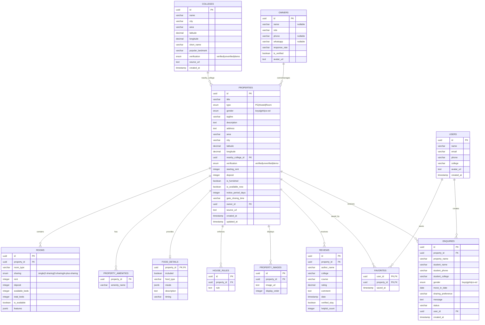

# Database Entity Relationship Diagram

This diagram maps the new normalized PostgreSQL schema that supports real-world data and provenance tracking while maintaining compatibility with the existing TypeScript interfaces.

